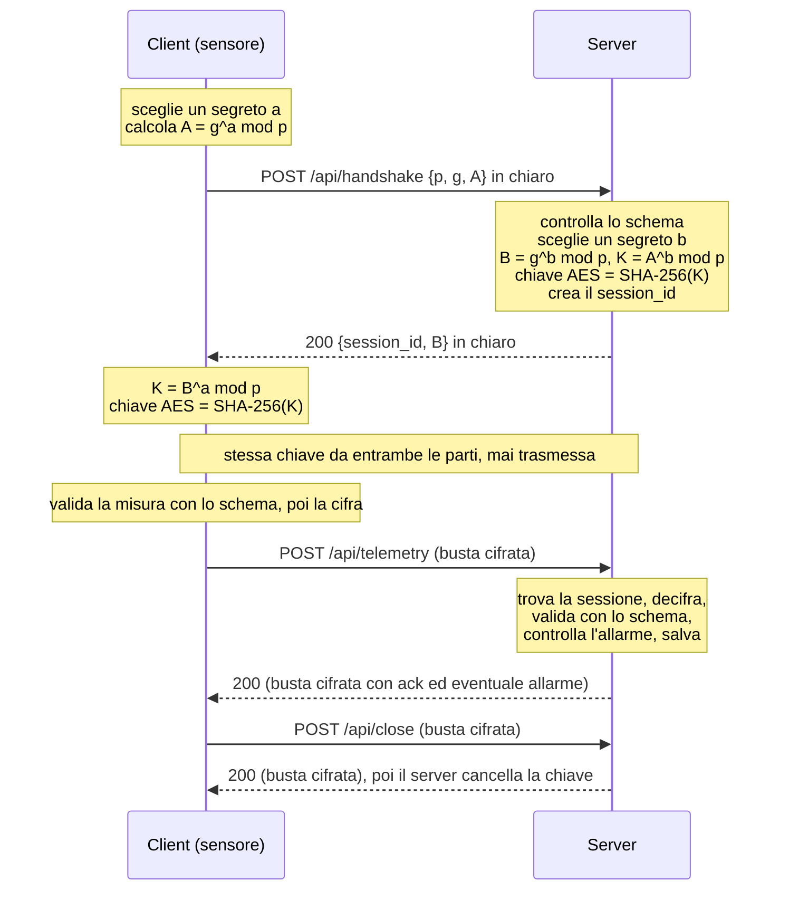

# Imberti_FrigoTrack
questo e il repositroy dedicato al progetto Telemetria sicura per la catena del freddo:
# FrigoTrack – Telemetria sicura per la catena del freddo

Progetto di TEP, classe 5IB. Autore: Imberti.

Dei sensori di temperatura inviano misure in JSON a un server HTTP. Il canale resta HTTP (niente HTTPS),
quindi la sicurezza la fa l'applicazione:

- la chiave si concorda con **Diffie-Hellman** (scritto da me) e **non viaggia mai in rete**;
- i messaggi viaggiano cifrati con **AES-GCM**, che scopre anche le manomissioni;
- ogni messaggio è controllato con un **JSON Schema** (le regole stanno nei file di `schemas/`);
- il server **salva le misure** in un file JSON e segnala un **allarme** se la temperatura esce dall'intervallo della merce.

Linguaggio: C# con .NET 8, due console app (Server e Client). Il server usa `HttpListener`, già incluso in .NET.
L'unico pacchetto esterno è `JsonSchema.Net`, che confronta un JSON con il suo schema.

## Come si avvia

Serve il .NET 8 SDK. La prima volta serve Internet per scaricare `JsonSchema.Net`.

```bash
dotnet run --project Server     # primo terminale: lascialo aperto
dotnet run --project Client     # secondo terminale: compare il menu
```

Con Visual Studio: apri `FrigoTrack.sln`, avvia prima **Server** e poi **Client**.

| Voce del menu | Cosa fa |
|---|---|
| 1 | Avvia 3 sensori insieme (10 misure ciascuno, una ogni 2 secondi). Una misura ogni 4 è fuori intervallo, così scatta l'allarme. |
| 2 | Demo: handshake, una misura valida e una non valida, mostrando cosa viaggia in rete. |
| 3 | Esegue i 7 test (il server deve essere acceso). |

Le misure ricevute sono in `data/readings.json` (lo crea il server).

## Struttura

```
FrigoTrack.sln
schemas/            10 JSON Schema, uno per ogni tipo di messaggio
Comune/             file usati da Server e Client
  Crypto.cs           Diffie-Hellman e AES-GCM
  SchemaValidator.cs  validazione con JsonSchema.Net
Server/Program.cs   endpoint, sessioni, allarmi, salvataggio
Client/
  Program.cs          menu, i 3 sensori, la demo
  Connection.cs       handshake e invio dei messaggi cifrati
  Tests.cs            i test
```

## Protocollo



Gruppo Diffie-Hellman: n. 14 dell'RFC 3526 (`p` da 2048 bit, `g = 2`). I numeri grandi viaggiano come testo esadecimale.
Lo schema `handshake-request` accetta solo quel `p` e quel `g` (parola chiave `const`).

### Endpoint (tutti POST)
| Endpoint | Richiesta | Risposta |
|---|---|---|
| `/api/handshake` | `{p, g, A}` in chiaro | `{session_id, B}` in chiaro |
| `/api/telemetry` | busta con la misura | busta con l'ack (ed eventuale allarme); la misura viene salvata |
| `/api/readings` | busta con `{sensor_id, from?, to?}` | busta con `{sensor_id, count, readings}` |
| `/api/close` | busta con `{"action":"close"}` | busta con `{"status":"closed"}`; poi sessione e chiave cancellate |

### Codici HTTP
| Codice | Quando |
|---|---|
| 200 | tutto bene |
| 400 | messaggio rifiutato dallo schema · decifratura o tag falliti (busta manomessa) |
| 401 | sessione scaduta (10 minuti senza messaggi) |
| 404 | sessione inesistente (anche dopo `/api/close`) · endpoint sconosciuto o metodo diverso da POST |

Gli errori dopo la decifratura viaggiano cifrati. Quelli prima (busta malformata, sessione inesistente o scaduta,
tag sbagliato) sono in chiaro, perché non c'è una chiave valida con cui cifrarli.

### La busta
```json
{ "session_id": "a3f9c2e1b7d04c58", "ciphertext": "mH3t...Base64...==", "tag": "8dK2...Base64...==" }
```
- `session_id`: l'unico dato in chiaro; serve al server per trovare la chiave giusta.
- `ciphertext`: Base64 di *nonce (12 byte casuali, nuovo a ogni messaggio) + testo cifrato*.
- `tag`: Base64 del tag GCM (16 byte). Se cambia anche un solo bit la decifratura fallisce.

Regola del server: **prima decifra, poi valida**. Se la decifratura o il tag falliscono risponde 400 senza elaborare nulla.

### Messaggio di esempio (prima di essere cifrato)
```json
{ "sensor_id": "CELLA-BG-007", "timestamp": "2026-11-02T08:15:30Z", "cargo_type": "pharma",
  "temperature_c": 4.6, "humidity": 55, "battery": 87 }
```

## Validazione con JSON Schema

`SchemaValidator.Validate(json, "nome")` legge `schemas/nome.schema.json` e lo dà a `JsonSchema.Net` (draft 2020-12).
Se il messaggio non è valido, la libreria dice **quale campo** e **perché**, e il server lo rimanda al client:

```json
{ "error": "99 è maggiore di 40", "field": "temperature_c" }
```

Nel codice non ci sono controlli sui singoli campi: per cambiare una regola si modifica lo schema, non il programma.

| Messaggio | File in `schemas/` | Chi lo valida |
|---|---|---|
| Richiesta handshake | `handshake-request` | server |
| Risposta handshake | `handshake-response` | client |
| Busta | `envelope` | server |
| Misura | `telemetry` | client (prima di cifrare) e server (dopo aver decifrato) |
| Conferma della misura | `telemetry-ack` | – |
| Richiesta misure | `readings-request` | client e server |
| Elenco misure | `readings-response` | – |
| Richiesta chiusura | `close-request` | client e server |
| Conferma chiusura | `close-response` | – |
| Errore | `error` | – |

Parole chiave usate: `type`, `required`, `enum`, `const`, `minimum`/`maximum`, `pattern`, `format: date-time`,
`minLength`, `additionalProperties: false`, `items`.

## Salvataggio e allarmi

Ogni misura accettata viene aggiunta a un elenco e il server riscrive `data/readings.json`, aggiungendo
`received_at` (ora di arrivo) e `alarm`. Al riavvio il file viene ricaricato.

| `cargo_type` | Intervallo di sicurezza |
|---|---|
| `food` | 0 … 4 °C |
| `pharma` | 2 … 8 °C |
| `frozen` | −25 … −18 °C |

Fuori intervallo → l'ack contiene `alarm: true` e `alarm_message`. Le soglie sono nel metodo `SafeRange` del server.

## Test (menu del client, voce 3, con il server acceso)

| # | Test |
|---|---|
| 1 | handshake riuscito: il server riesce a decifrare, quindi le due chiavi coincidono |
| 2 | misura valida → 200 |
| 3 | misura non valida → 400 con il campo sbagliato (il client non la invia nemmeno) |
| 4 | busta manomessa → 400 |
| 5 | sessione inesistente → 404 |
| 6 | temperatura fuori intervallo → allarme |
| 7 | `/api/readings` restituisce le misure salvate e il filtro `from` funziona |

